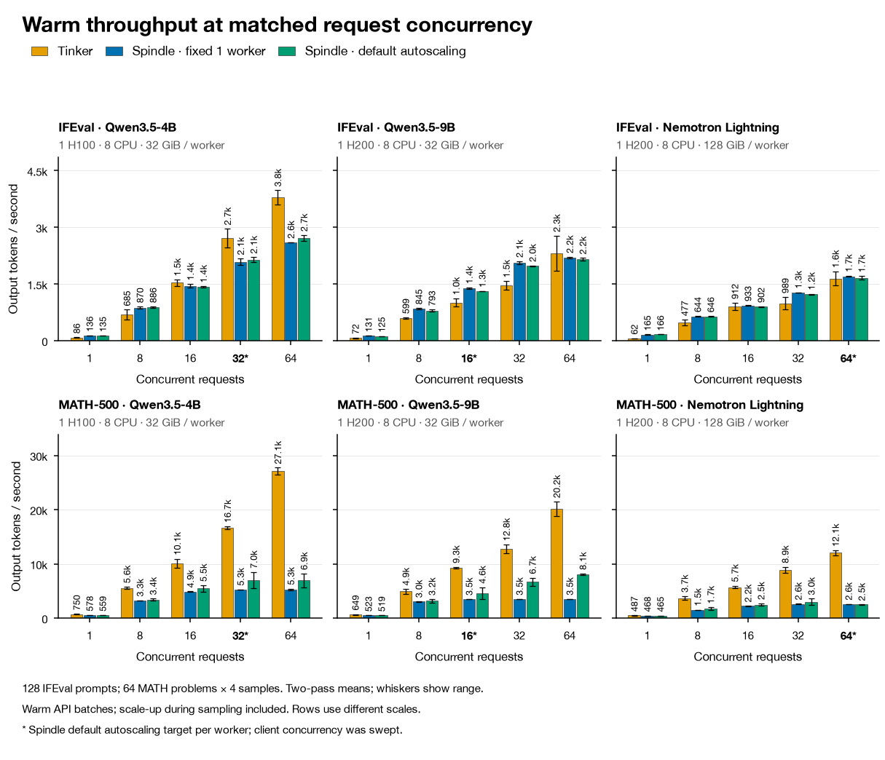
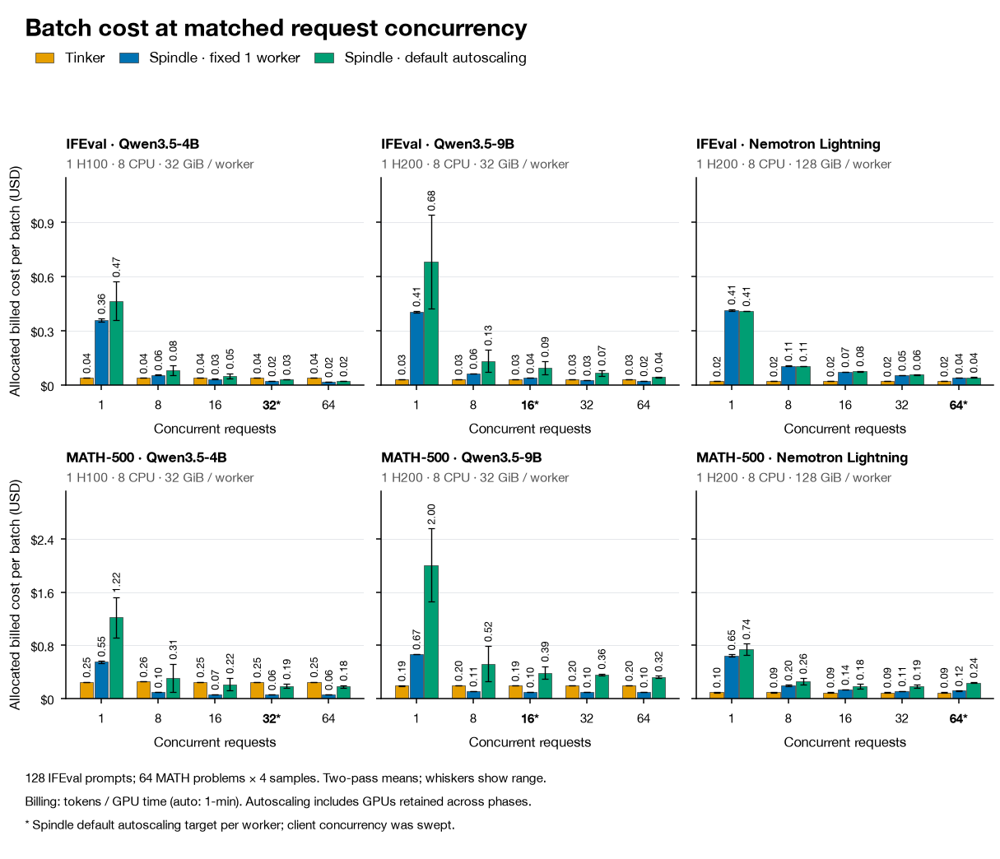

# Spindle Small Model Evals

Evaluation code and measured comparisons of hosted Tinker against Spindle v0.1.4 on Modal, using Qwen3.5-4B, Qwen3.5-9B and NVIDIA Nemotron-3.5-Lightning-30B-A3B.

## Final comparison





Three settings: **Tinker**, **Spindle fixed at one worker per model**, and **Spindle default autoscaling**. Each benchmark/model has five client-concurrency settings (1, 8, 16, 32, 64) and two passes. The second pass reverses both task and concurrency order.

- IFEval performance subset: 128 prompts, one response each, max 1,280 tokens, greedy.
- MATH-500 performance subset: 64 problems, four responses each, max 2,048 tokens, temperature 0.6.
- Spindle worker hardware: 4B = 1 H100 / 8 CPU cores / 32 GiB RAM; 9B = 1 H200 / 8 cores / 32 GiB; Nemotron = 1 H200 / 8 cores / 128 GiB.
- Default worker ranges are 0–8 / 0–8 / 0–4. Asterisks mark default autoscaling targets of 32 / 16 / 64 per worker, not default client load or enabled autoscaling in the fixed-worker series.

Throughput is completed output tokens divided by the native-API batch duration. Initial loading/probes are excluded; scale-up and retries during a measured batch remain included. There are no first-token timestamps. Whiskers show the range of two passes, not confidence intervals. Tinker's GPU allocation is unknown, and its measurements were taken earlier than the autoscaling run.

Costs are **billing-backed allocations to measured batches**, not directly returned per-request charges. Tinker uses saved token counts at invoice-derived effective rates; Spindle uses hourly worker bills allocated by GPU time (one-minute GPU samples for autoscaling). Outside-batch charges and shared frontend are excluded. Capacity was not reset between phases: the default 300-second scale-down window can retain idle GPUs from an earlier phase or warm-up, so low-concurrency autoscaling costs depend on sweep order and are not steady-state costs. The scripts' older `published_rate_cost_estimate_usd` fields are historical list-rate estimates, not the source of the final billed-cost bars.

## Branches behind these charts

| Series | Experiment branch | Recorded commit(s) | Run ID(s) |
|---|---|---|---|
| Tinker + fixed-worker Spindle | [`orx/controlled-warm-throughput-matched-concurrency-a`](https://github.com/sox8502/spindle-small-model-evals/tree/orx/controlled-warm-throughput-matched-concurrency-a) | [`88433ff`](https://github.com/sox8502/spindle-small-model-evals/commit/88433fff38b8dc9e1067e2236ffcd56500ce0981), retained IFEval from `0d84dc3` | `822fee2a-efb1-4112-865a-be28c196867e`; retained phases from `c527d650-9968-4721-8a38-d362e567b652` |
| Default-autoscaling Spindle | [`orx/controlled-warm-throughput-default-autoscaling-t`](https://github.com/sox8502/spindle-small-model-evals/tree/orx/controlled-warm-throughput-default-autoscaling-t) | [`6c2fe07`](https://github.com/sox8502/spindle-small-model-evals/commit/6c2fe07) | `9242dae2-1a02-4ba4-bf46-efe71a22527f` |

The first controlled attempt was interrupted by host sleep. Only 30 validated IFEval phases from before suspension were retained; all affected work was excluded and MATH was rerun. The autoscaling attempt at `88dde0e` failed a preflight check before any measured batch; `6c2fe07` accepts Modal's unset minimum-worker representation and ran successfully.

[`main`](https://github.com/sox8502/spindle-small-model-evals/tree/main) contains the latest autoscaling source plus this publication index, final plotting code, and aggregate data. Recorded experiment branches and their commits are preserved unchanged. See [all experiment branches](docs/experiments.md).

## Reproduce the charts without GPUs

Install [uv](https://docs.astral.sh/uv/), then run from the repository root:

```bash
uv run --no-project analysis/controlled-autoscaling-2026-11-05/figures/plot_comparison.py
```

The plotting script declares its own matplotlib/numpy dependencies. It reads the included [aggregate measurements](analysis/controlled-autoscaling-2026-11-05/aggregated-results.json) and [recipe defaults](analysis/controlled-warm-throughput-2026-11-03/default-spindle-configs-v0.1.4.json), and regenerates PNG, SVG and PDF. [CSV values](analysis/controlled-autoscaling-2026-11-05/chart-data.csv) are also included. In the JSON, `total_*` fields sum both passes; plotted values and other unsuffixed metrics are two-pass means, with `_min`/`_max` recording their range. The final cost chart uses `allocated_billed_cost_usd`; the older `active_window_cost_estimate_usd` fields are historical estimates.

## Run the evaluations

Python 3.12 and authenticated Modal access to an environment named `main` are required (the environment is hard-coded in `run_evals.sh` and `evals/controlled.py`). `pyproject.toml` pins Spindle to v0.1.4 and the Tinker SDK to 0.33.x; `uv.lock` records dependencies.

```bash
uv sync --locked
uv run --locked python -m unittest evals.test_controlled
```

Check out the experiment branch you want before launching. The current `bash run_evals.sh` runs the **autoscaling-only** sweep; the matched-concurrency branch runs the Tinker/fixed-worker controller (its last revision reuses validated first-pass IFEval, so use the recorded source/provenance when reproducing the complete combined series). The public main branch includes the saved `reference/controlled/` inputs for the autoscaling sweep; the older controller selects its prompts from the benchmark datasets.

Running the sweep launches paid Modal GPUs. Authenticate with your own Modal account, and create the proxy-token secret expected by the bundled recipes (these commands configure your account):

```bash
export MODAL_ENVIRONMENT=main
uv run --locked modal workspace proxy-tokens create
# Set these to the Modal-Key and Modal-Secret returned above:
export MODAL_PROXY_TOKEN_ID='<your-Modal-Key>'
export MODAL_PROXY_TOKEN_SECRET='<your-Modal-Secret>'
uv run --locked modal workspace proxy-tokens allow "$MODAL_PROXY_TOKEN_ID" "$MODAL_ENVIRONMENT"
uv run --locked modal secret create spindle-proxy \
  MODAL_PROXY_TOKEN_ID="$MODAL_PROXY_TOKEN_ID" \
  MODAL_PROXY_TOKEN_SECRET="$MODAL_PROXY_TOKEN_SECRET"
```

The bundled recipes also reference `huggingface-secret`; provision that secret with your own `HF_TOKEN` for weight downloads. Hosted Tinker runs additionally require your own `TINKER_API_KEY`. Never put either token in Git.

The original research runner supplies `ORX_RUN_ID` automatically. For a direct standalone run, supply any unique metadata label:

```bash
ORX_RUN_ID=manual-autoscaling-run bash run_evals.sh
```

The run script creates an isolated frontend credential and cleans up its worker apps on exit. On macOS it prevents sleep for the controller's lifetime. If sharing a Modal workspace, rename the deployment prefix consistently in `run_evals.sh`, `evals/controlled.py` (`PREFIX`), and the three model configuration files in `spindle_configs/`.

The standalone modules `evals/ifeval.py`, `evals/math500.py`, `evals/spindle_cost.py` and the 2B configuration are retained from earlier full-suite experiments; they are not the controlled sweep entry point.

Raw cloud logs, account billing responses, credentials and local research-tool configuration are not included in this publication. The public aggregate data is sufficient to regenerate the two charts; recalculating allocations from raw billing requires the account-side records.
